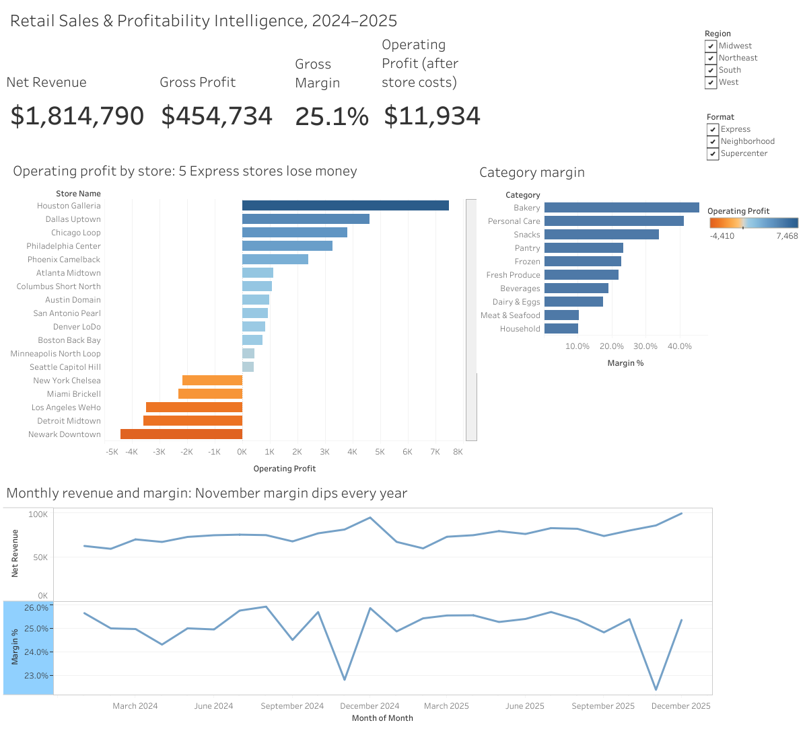
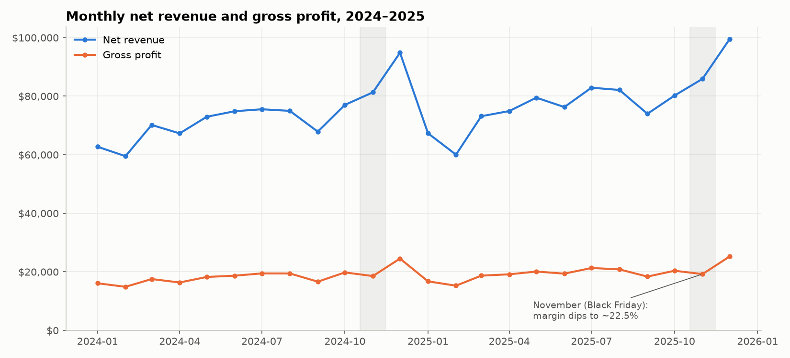
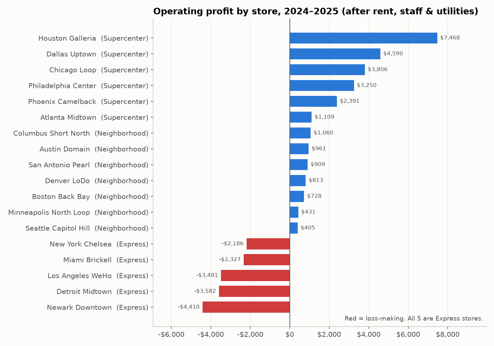
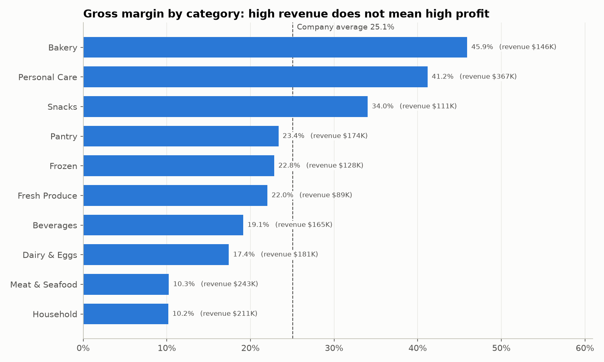
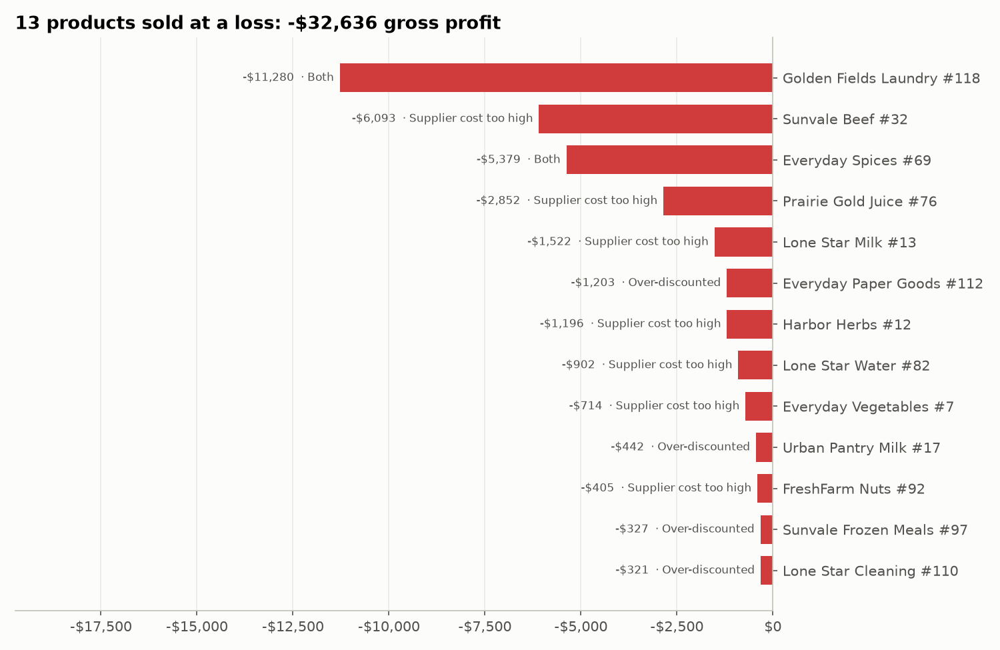
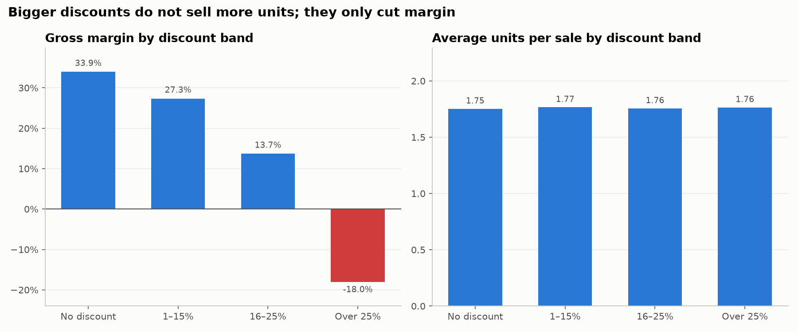

# Retail Sales & Profitability Intelligence

**End-to-end profitability analysis of an 18-store retail chain (2024–2025) using SQL, Python, Excel and Tableau.**

🔗 **[View the interactive Tableau dashboard](https://public.tableau.com/views/RetailSalesProfitabilityDashboard_17942567393830/ExecutiveDashboard)**



---

## Business Problem

The chain's revenue is growing, but management doesn't know **where the money is actually made and where it is lost**. I was asked to answer:

1. How are revenue, gross profit and margins trending?
2. Which stores and regions perform best and worst?
3. Which stores and products are loss-making, and why?
4. Do discounts and promotions actually pay off?

**Goal:** improve profitability and identify growth opportunities.

---

## Dataset

Real store-level P&L data is confidential, so I generated a **realistic simulated dataset** (`python/00_generate_data.py`) that behaves like a real POS export:

| Table | Rows | Description |
|---|---|---|
| `sales_transactions` | 133,057 | Line-level sales, Jan 2024 – Dec 2025 |
| `products` | 132 | 10 categories, list price and unit cost |
| `stores` | 18 | 4 regions, 3 formats (Supercenter, Neighborhood, Express), monthly operating cost |

The raw data deliberately includes real-world problems: duplicates, returns, missing values, inconsistent text and mixed date formats.

---

## Tools & What I Used Them For

| Tool | Used for |
|---|---|
| **SQL (DuckDB)** | Data quality checks, cleaning, and 5 business-question queries (CTEs, window functions, CASE logic) |
| **Python (pandas, matplotlib)** | Reproducible analysis, 5 charts, data export for Excel and Tableau |
| **Excel** | Store P&L with `SUMIFS` / `XLOOKUP`, pivot tables with calculated fields and slicers, executive summary |
| **Tableau Public** | Interactive executive dashboard with KPI cards and Region / Format filters |

---

## Approach

### 1. Data quality check and cleaning (SQL)

| Issue found | Rows | Fix |
|---|---|---|
| Duplicate transactions | 350 | `ROW_NUMBER() OVER (PARTITION BY order_id)`, keeping 1 copy |
| Mixed date formats (`MM/DD/YYYY`) | 399 | `TRY_STRPTIME` + `COALESCE` across both formats |
| Missing discount | 532 | Set to 0 (most common value; NULL would drop revenue) |
| Missing / messy payment method | 266 + casing and trailing spaces | `TRIM`, `UPPER` and a `CASE` mapping; blanks labelled `Unknown` |
| Returns (negative quantity) | 3,244 | Kept and flagged with `is_return` |

> `SELECT DISTINCT` would have removed only **339** of the 350 duplicates, because 11 copies had different formatting. Deduplicating on `order_id` caught all of them.

**Result:** 132,707 clean transactions. I reconciled the totals across SQL, Python, Excel and Tableau, and they match.

### 2. Profit model
- **Net revenue** = quantity × price × (1 − discount)
- **Gross profit** = net revenue − COGS
- **Operating profit** = gross profit − store operating costs (rent, staff, utilities)

### 3. Analysis
Five business questions answered in `sql/03_business_analysis.sql`, then visualised in Python, Excel and Tableau.

---

## Key Insights

### Headline numbers (2024–2025)

| Net Revenue | Gross Profit | Gross Margin | Operating Profit | YoY Growth |
|---|---|---|---|---|
| $1.81M | $454.7K | 25.1% | **$11.9K (0.7%)** | +6.5% |

**1. The business is growing, but almost nothing reaches the bottom line.**
Revenue grew **6.5%** to $936K in 2025, and gross margin held steady at ~25%. But after store running costs, operating profit is only **$11.9K, a 0.7% margin**.



**2. All 5 Express stores lose money.**
Newark, Detroit, Los Angeles, Miami and New York lost **≈ $16K combined (−8.6% operating margin)**. That wipes out more than half of what the 6 Supercenters earn. Another **7 stores are "at risk"**, with operating margins under 1%. Excluding the Express stores, operating profit would rise from $11.9K to **≈ $27.9K**.



**3. High revenue doesn't mean high profit.**
- **Personal Care** earns **33% of all gross profit** at a 41% margin.
- **Bakery** has the best margin, at **46%**.
- **Meat & Seafood** is the 2nd-largest category by revenue ($243K) but keeps only a **10% margin**.
- **Household** has the lowest margin (10%) and the highest discount rate (16%).



**4. 13 products are sold at a loss, costing $32.6K in gross profit.**
- **9** have supplier costs at 94%+ of shelf price; 6 actually cost more than they sell for.
- **4** are profitable products ruined by permanent 30%+ discounts.
- The single worst product, *Golden Fields Laundry #118*, loses **$11.3K** from both problems combined.



**5. Discounts don't drive extra volume. They only cut margin.**
- Discounts totalled **$215K, equal to 47% of gross profit**.
- Average units per sale is **~1.76 in every discount band**, so customers don't buy more when the discount is bigger.
- Margin falls from **34% (no discount) to −18% (over 25% off)**, and **69%** of deep-discount sales are below cost.
- **November** (Black Friday) margin drops to ~22.5% in both years.



**6. Regional growth.**
- The **South** generates **41%** of revenue, and Houston Galleria is the most profitable store (+$7.5K).
- The **Midwest grew fastest (+7.9%)** and the **West slowest (+5.1%)**.

---

## Recommendations

| # | Recommendation | Estimated impact |
|---|---|---|
| 1 | **Review the Express format**: renegotiate leases, cut hours, and tighten markdowns at Newark and Detroit; close the weakest if they don't improve | Up to **+$16K** operating profit (more than doubles it) |
| 2 | **Cap discounts at 25%** and require margin approval for anything deeper | Recovering half the over-25% losses is **≈ +$8K** |
| 3 | **Fix the 13 loss-making SKUs**: renegotiate supplier costs or reprice the 9 below-cost items; stop permanent promotions on the other 4 | Up to **+$32.6K** gross profit |
| 4 | **Rethink Black Friday depth**: target the promotion instead of discounting the whole store | Recover ~3 margin points in November |
| 5 | **Grow high-margin categories**: more space and promotion for Personal Care, Bakery and Snacks | Shifts the mix toward 34–46% margin categories |

*The impacts overlap (some loss-making products are sold in Express stores), so they shouldn't be added together.*

---

## Repository Structure

```
retail-sales-profitability-analysis/
├── data/
│   ├── raw/                  # stores.csv, products.csv, sales_transactions.csv
│   └── processed/            # sales_clean.csv (cleaned, enriched)
├── sql/
│   ├── 01_load_and_quality_check.sql
│   ├── 02_clean_and_enrich.sql
│   ├── 03_business_analysis.sql      # 5 business questions
│   ├── explore_duplicates.sql        # investigation: DISTINCT vs ROW_NUMBER
│   └── explore_cleaning.sql          # investigation: dates, discounts, text
├── python/
│   ├── 00_generate_data.py           # builds the simulated dataset
│   ├── run_sql.py                    # runs a .sql file against DuckDB
│   └── 01_charts_and_export.py       # charts + exports for Excel/Tableau
├── excel/
│   └── Retail_Profitability_Analysis.xlsx   # Store P&L, pivots, summary
├── images/                           # charts and dashboard screenshot
├── requirements.txt
└── README.md
```

---

## How to Run

```bash
pip install -r requirements.txt
python python/00_generate_data.py
python python/run_sql.py sql/01_load_and_quality_check.sql
python python/run_sql.py sql/02_clean_and_enrich.sql
python python/run_sql.py sql/03_business_analysis.sql
python python/01_charts_and_export.py
```

---

## What I Learned

- **Gross margin can hide a problem.** Every store looked healthy at ~25% gross margin; only operating profit showed that 5 stores lose money.
- **Always check your cleaning method.** `DISTINCT` looked right but silently missed 11 duplicates.
- **Reconcile across tools.** Getting the same numbers in SQL, Python, Excel and Tableau gave me confidence the analysis is correct.

---

**Abrar Ahmed Syed** · [LinkedIn](https://www.linkedin.com/in/abrar313) · [Tableau Public](https://public.tableau.com/views/RetailSalesProfitabilityDashboard_17942567393830/ExecutiveDashboard)
